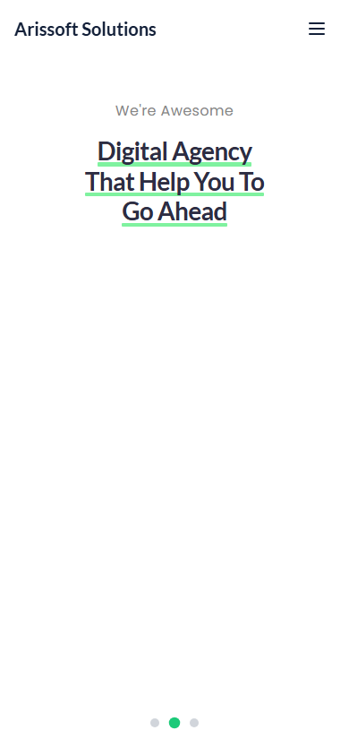

# Design notes

## Visual direction

Arissoft uses a white and pale-mint canvas with dark navy text and green emphasis. The desktop hero balances a large multiline headline with a rounded technology image; green underlines tie the headline to the brand accent. Supporting sections alternate image-led content, service cards and text sections.

Typography combines Poppins for body text, Lato for headings and Cairo for hero treatments. These families are loaded through Google Fonts in `index.html` and mapped in `tailwind.config.ts`. Color, radius and shadow tokens live in `src/index.css`.

## Layout and interaction

The home page assembles the hero, experience, industries, solution spectrum and service sections. About, Services and Contact reuse navigation, footer and page-header components.

Desktop navigation becomes a menu button on smaller screens. The mobile hero prioritizes the headline and slide indicators while hiding large decorative image elements. The three-slide hero rotates on a six-second interval; Framer Motion handles hero and page transitions. Contact submission feedback is driven by a React Query mutation.

## Repository screenshots

| View | Image |
| --- | --- |
| Home, desktop | [Open screenshot](images/home-desktop.png) |
| Home, mobile | [Open screenshot](images/home-mobile.png) |
| About, desktop | [Open screenshot](images/about-desktop.png) |
| About, mobile | [Open screenshot](images/about-mobile.png) |
| Desktop and mobile presentation | [Open presentation](images/devices.webp) |

## Metadata

`index.html` contains the homepage title and description, canonical URL, Open Graph and Twitter metadata, favicon links and robots metadata. Route components update the browser title for Home, About, Services and Contact. `public/robots.txt` permits crawlers, and `public/og-image.png` supplies the configured social image.

## Maintaining the design

Keep new page sections aligned with the shared color tokens and heading families. Check desktop and narrow layouts when editing navigation, hero line breaks or card grids. Review keyboard focus, image alternative text and animation preferences when extending interactions.

